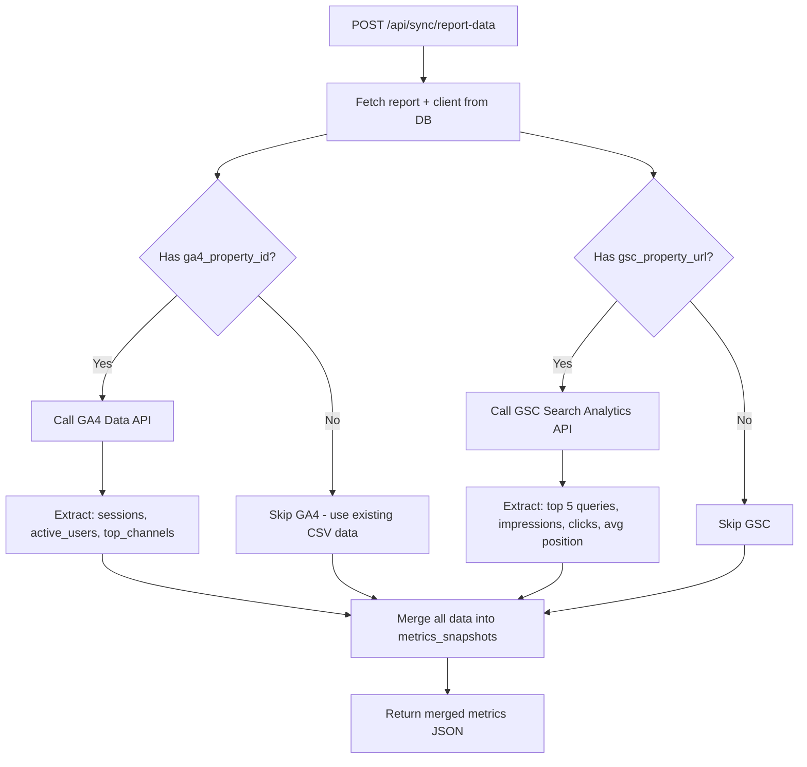

# Admin Backend Enterprise Hub — Implementation Plan

> **Revision 1** — Full overhaul of the admin backend into a structured Client Hub with live API integrations.

---

## Current State Analysis

| Area | Current State | Target State |
|------|-------------|-------------|
| `/admin` | Flat client list + inline report list | Client directory → `/admin/client/[id]` hub |
| `/admin/reports/[id]` | Single metrics grid + one AI narrative | Tabbed editor: Data, AI Sections, Annotations, Publish |
| AI Generation | Single monolithic summary | 3 granular sections: Executive, Technical, Traffic |
| API Integrations | None (CSV only) | GA4 + GSC via Service Account + CSV fallback |
| Report Status | `draft` / `published` (text, no constraint) | `draft` / `pending_approval` / `published` |
| Jira | Mock UI only | Real ticket creation via Atlassian REST API |
| DB Schema | No integration fields on clients | `ga4_property_id`, `gsc_property_url`, `seranking_api_key`, `jira_api_key` |

---

## Architecture Overview

```mermaid
graph TD
    A[/admin] --> B[Client Directory List]
    B --> C[/admin/client/id - Client Hub]
    C --> D[Settings Tab]
    C --> E[Integrations Tab]
    C --> F[Reports Tab]
    F --> G[New Report Button]
    G --> H[Report Upload Dialog - CSV + Month]
    F --> I[Report Row - click to edit]
    I --> J[/admin/reports/id - Report Editor]
    J --> K[Data Panel - metrics tables]
    J --> L[AI Sections Panel]
    L --> L1[Executive Summary - Generate]
    L --> L2[Technical Health - Generate]
    L --> L3[Traffic and Visibility - Generate]
    J --> M[Analyst Annotations Panel]
    J --> N[Sticky Action Bar]
    N --> N1[Submit for Approval]
    N --> N2[Publish to Client Portal]
    N --> N3[Copy Portal Link]
```

---

## File Structure (New/Modified)

```
my-app/
├── app/
│   ├── admin/
│   │   ├── page.tsx                              # MODIFY - client directory list
│   │   ├── client/
│   │   │   └── [id]/
│   │   │       └── page.tsx                      # NEW - client hub with tabs
│   │   └── reports/
│   │       └── [id]/
│   │           └── page.tsx                      # MODIFY - full analyst editor
│   └── api/
│       ├── generate-summary/
│       │   └── route.ts                          # MODIFY - add section param
│       ├── sync/
│       │   └── report-data/
│       │       └── route.ts                      # NEW - GA4 + GSC sync
│       └── requests/
│           └── create/
│               └── route.ts                      # NEW - Jira ticket creation
├── components/
│   ├── admin/
│   │   ├── client-hub-tabs.tsx                   # NEW - Settings/Integrations/Reports tabs
│   │   ├── client-settings-form.tsx              # NEW - edit company info + logo
│   │   ├── client-integrations-form.tsx          # NEW - GA4/GSC/API key inputs
│   │   ├── report-status-badge.tsx               # NEW - draft/pending/published badge
│   │   ├── report-editor-metrics.tsx             # NEW - data tables panel
│   │   ├── report-editor-ai.tsx                  # NEW - 3-section AI generator
│   │   ├── report-editor-annotations.tsx         # NEW - analyst notes inputs
│   │   └── report-publish-bar.tsx                # NEW - sticky action bar
│   └── (existing components preserved)
├── lib/
│   └── types.ts                                  # MODIFY - add new DB fields
└── supabase/
    └── migrations/
        ├── 20260622150000_admin_hub_schema.sql   # NEW - schema updates
        └── 20260622150100_seed_march_report.sql  # NEW - historical baseline data
```

---

## Phase 1: Database Updates & Historical Seeding

### 1.1 Schema Migration
**File:** `supabase/migrations/20260622150000_admin_hub_schema.sql`

**`reports` table changes:**
- Add `CHECK` constraint on `published_status` to enforce `'draft'`, `'pending_approval'`, `'published'`
- Add `analyst_notes` JSONB column (stores per-section notes: `{executive: "", technical: "", traffic: ""}`)

**`clients` table additions:**
- `jira_api_key TEXT` — Atlassian API token (nullable)
- `jira_email TEXT` — Atlassian account email for Basic Auth (nullable)
- `jira_project_key TEXT` — Jira project key e.g. `"BD"` (nullable)
- `ga4_property_id TEXT` — e.g. `"properties/123456789"` (nullable)
- `gsc_property_url TEXT` — e.g. `"https://example.com/"` (nullable)
- `seranking_api_key TEXT` — SE Ranking API key (nullable)

**`narratives` table changes:**
- Add `section TEXT NOT NULL DEFAULT 'executive'` — identifies which section: `executive`, `technical`, `traffic`
- Update unique constraint: one narrative per `(report_id, section)` pair

### 1.2 Historical Baseline Seed
**File:** `supabase/migrations/20260622150100_seed_march_report.sql`

- Create a "March 2026" report for the existing Test Company client
- Insert a `metrics_snapshots` row with realistic technical health data (slightly worse than the May 2026 report to show MoM improvement)
- Insert 3 narrative rows (one per section) with placeholder text
- This gives the frontend MoM comparison data for the UI demonstration

### 1.3 Update TypeScript Types
**File:** `my-app/lib/types.ts`
- Add all new columns to `Client` Row/Insert/Update types
- Add `analyst_notes` to `Report` types
- Add `section` to `Narrative` types

### 1.4 Update `.env.local` Template
Add placeholder keys with comments:
```bash
# Google Service Account (base64-encoded JSON)
GOOGLE_SERVICE_ACCOUNT_JSON=

# Jira Integration (set per-client in DB, these are fallback defaults)
JIRA_BASE_URL=https://yourcompany.atlassian.net
```

---

## Phase 2: Client Admin Hub Hierarchy

### 2.1 Refactor `/admin` — Client Directory
**File:** `my-app/app/admin/page.tsx`
- Remove the inline `ReportList` and client detail panel
- Render a clean grid/table of all clients
- Each client card shows: company name, color dot, logo, report count, last report status
- "New Client" button (keep existing `ClientForm` component)
- Clicking a client navigates to `/admin/client/[id]`

### 2.2 New Client Hub — `/admin/client/[id]`
**File:** `my-app/app/admin/client/[id]/page.tsx`

Tabbed layout with 3 tabs:

**Tab 1: Settings**
- Edit `company_name`, `primary_color_hex`, `logo_url`, `custom_ai_prompt`
- Save button → `UPDATE clients SET ...`

**Tab 2: Integrations**
- Form fields for: `ga4_property_id`, `gsc_property_url`, `seranking_api_key`, `jira_api_key`, `jira_email`, `jira_project_key`
- Each field has a subtle help text explaining what to enter
- "Test Connection" button for GA4 (calls `/api/sync/report-data` with a dry-run flag)
- Save button → `UPDATE clients SET ...`

**Tab 3: Reports**
- Table of all reports for this client: Month, Status badge, Created date, Actions
- "New Report" button → opens the existing `ReportUpload` dialog (CSV dropzone)
- Clicking a report row → navigates to `/admin/reports/[id]`

### 2.3 Report Status Badge Component
**File:** `my-app/components/admin/report-status-badge.tsx`
- `draft` → grey badge
- `pending_approval` → amber badge with clock icon
- `published` → green badge with check icon

---

## Phase 3: Live API Data Engine & CSV Fallback

### 3.1 Install Dependencies
```bash
npm install @google-analytics/data googleapis
```

### 3.2 API Route: `/api/sync/report-data`
**File:** `my-app/app/api/sync/report-data/route.ts`

**Request body:**
```json
{
  "report_id": "uuid",
  "dry_run": false
}
```

**Execution flow:**



**GA4 Integration:**
- Auth: Service Account JSON from `GOOGLE_SERVICE_ACCOUNT_JSON` env var (base64-decoded)
- Client: `@google-analytics/data` `BetaAnalyticsDataClient`
- Metrics: `sessions`, `activeUsers`
- Dimensions: `sessionDefaultChannelGroup` (for traffic by channel)
- Date range: first to last day of `reporting_month`

**GSC Integration:**
- Auth: Same Service Account (needs Search Console API enabled)
- Client: `googleapis` `google.searchconsole('v1')`
- Query: `searchAnalytics.query` for top 5 queries by clicks
- Fields: `query`, `clicks`, `impressions`, `ctr`, `position`

**Data Storage:**
- Merge GA4 + GSC data into the existing `metrics_snapshots` row's `data_json`
- Preserve existing Screaming Frog CSV fields (don't overwrite)
- Add new keys: `ga4_sessions`, `ga4_active_users`, `ga4_channels`, `gsc_top_queries`

### 3.3 CSV Fallback
- The existing `ReportUpload` component and CSV parsing logic is **preserved unchanged**
- If GA4/GSC keys are not configured, the sync route gracefully skips those sections
- The analyst can always manually upload a CSV to populate technical health metrics

---

## Phase 4: Analyst Editor & Annotation Engine

### 4.1 Refactor `/admin/reports/[id]`
**File:** `my-app/app/admin/reports/[id]/page.tsx`

Replace the current single-column layout with a two-panel layout:
- **Left panel (60%):** Data visibility + AI sections + annotations
- **Right panel (40%):** Sticky metrics summary sidebar

### 4.2 Data Visibility Panel
**File:** `my-app/components/admin/report-editor-metrics.tsx`
- Display all metrics from `metrics_snapshots` in clean data tables
- Section 1: Technical Health (Screaming Frog data)
- Section 2: GA4 Traffic (sessions, users, channels table)
- Section 3: GSC Visibility (top queries table)
- "Sync Live Data" button → calls `/api/sync/report-data`

### 4.3 Granular AI Sections
**File:** `my-app/components/admin/report-editor-ai.tsx`

Three independent AI generation blocks:

| Section | Prompt Focus | DB Section Key |
|---------|-------------|----------------|
| Executive Summary | Overall performance, key wins/concerns | `executive` |
| Technical Health | Crawl errors, indexability, redirects | `technical` |
| Traffic & Visibility | GA4 sessions, GSC queries, channel mix | `traffic` |

Each block has:
- Section title (no emoji)
- Editable `<Textarea>` showing current narrative
- "Generate with AI" button → calls updated `/api/generate-summary` with `{ report_id, section }`
- "Save" button → updates the specific narrative row

### 4.4 Updated AI Route
**File:** `my-app/app/api/generate-summary/route.ts`

**Changes:**
- Accept `section: 'executive' | 'technical' | 'traffic'` in request body
- Use section-specific system prompts:
  - **Executive:** "Write a 3-sentence executive summary. Do NOT include the company name or report title in your output. Output only the raw narrative paragraph."
  - **Technical:** "Analyse the technical health metrics and write 2-3 sentences on crawl health. Do NOT include the company name or report title."
  - **Traffic:** "Analyse the GA4 and GSC data and write 2-3 sentences on traffic performance. Do NOT include the company name or report title."
- Save to the correct `narratives` row filtered by `(report_id, section)`

### 4.5 Analyst Annotations
**File:** `my-app/components/admin/report-editor-annotations.tsx`
- Three text inputs (one per section) for analyst notes
- Saved to `reports.analyst_notes` JSONB column: `{executive: "...", technical: "...", traffic: "..."}`
- These notes render on the client-facing portal below each chart (replacing the current hardcoded `AnalystAnnotation` text)

---

## Phase 5: Publishing Workflow & Jira Integration

### 5.1 Sticky Action Bar
**File:** `my-app/components/admin/report-publish-bar.tsx`

Fixed to the bottom of the report editor page. Shows different actions based on current `published_status`:

| Current Status | Available Actions |
|---------------|------------------|
| `draft` | "Submit for Approval" button |
| `pending_approval` | "Approve & Publish" button + "Reject to Draft" button |
| `published` | "Copy Portal Link" button (copies URL with `?key=`) + "Unpublish" button |

**"Submit for Approval":** `UPDATE reports SET published_status = 'pending_approval'`

**"Approve & Publish":** `UPDATE reports SET published_status = 'published'` — the `secure_access_token` already exists on the client, so the portal link is immediately available.

**"Copy Portal Link":** Constructs and copies `https://[domain]/report/[id]?tab=seo&key=[client.secure_access_token]`

### 5.2 Jira API Route
**File:** `my-app/app/api/requests/create/route.ts`

**Request body (from client portal Requests tab):**
```json
{
  "client_id": "uuid",
  "title": "Update homepage meta descriptions",
  "description": "Please update...",
  "priority": "Medium"
}
```

**Execution:**
1. Fetch client from DB to get `jira_api_key`, `jira_email`, `jira_project_key`
2. If any Jira fields are missing → return `{ success: false, fallback: true }` (UI shows "Request logged locally")
3. If all present → `fetch` to `https://[JIRA_BASE_URL]/rest/api/3/issue` with Basic Auth
4. Map priority: `Low → Low`, `Medium → Medium`, `High → High`, `Urgent → Highest`
5. Return Jira issue key (e.g. `BD-1043`) on success

**Update `requests-view.tsx`:**
- On form submit, call `/api/requests/create` instead of just showing a success toast
- If Jira key returned → show "Ticket BD-1043 created in Jira" success state
- If fallback → show "Request logged. Your account manager will be in touch."

---

## Key Technical Decisions

1. **Google Auth:** Service Account JSON stored as a base64-encoded string in `GOOGLE_SERVICE_ACCOUNT_JSON` env var. Decoded at runtime in the API route. This avoids multi-line JSON issues in `.env.local`.

2. **Narrative sections:** Rather than adding a `section` column to `narratives`, we use the existing `metric_category` pattern — each narrative row has a `section` field. The `(report_id, section)` pair is unique. This is backward-compatible with the existing single-narrative reports (they'll have `section = 'executive'`).

3. **Analyst notes in JSONB:** Storing all 3 annotation fields in a single `reports.analyst_notes` JSONB column avoids a new table and keeps the schema simple for MVP.

4. **Admin routing:** `/admin/client/[id]` is a new route. The existing `/admin/reports/[id]` route is preserved but heavily refactored. The back-navigation chain is: `/admin` → `/admin/client/[id]` → `/admin/reports/[id]`.

5. **CSV fallback preserved:** The `ReportUpload` component and Screaming Frog CSV parsing are kept exactly as-is. The new sync route adds GA4/GSC data on top of whatever CSV data exists.

6. **No breaking changes to client portal:** The `secure_access_token` and portal URL format remain unchanged. Publishing simply sets `published_status = 'published'` — the token already exists.

---

## Environment Variables Required

```bash
# Existing
ANTHROPIC_API_KEY=...
NEXT_PUBLIC_SUPABASE_URL=...
NEXT_PUBLIC_SUPABASE_ANON_KEY=...

# New - Google APIs (Service Account)
GOOGLE_SERVICE_ACCOUNT_JSON=  # base64-encoded service account JSON

# New - Jira (global fallback, overridden by per-client DB values)
JIRA_BASE_URL=https://yourcompany.atlassian.net
```

---

## Execution Order

1. **Phase 1 first** — DB migrations must run before any code changes that reference new columns
2. **Phase 2** — New routing hierarchy (no external dependencies)
3. **Phase 3** — API routes (requires npm install + env vars)
4. **Phase 4** — Report editor refactor (depends on Phase 1 schema + Phase 3 sync route)
5. **Phase 5** — Publishing bar + Jira route (depends on Phase 1 status constraint)
