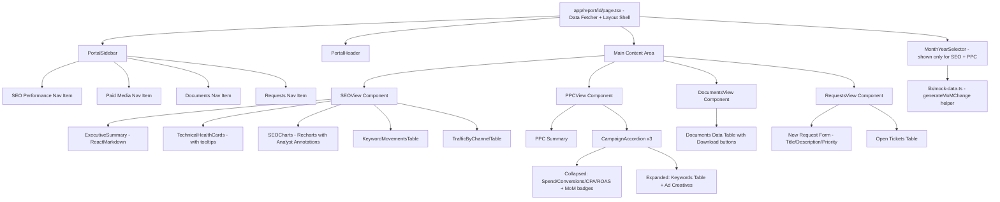
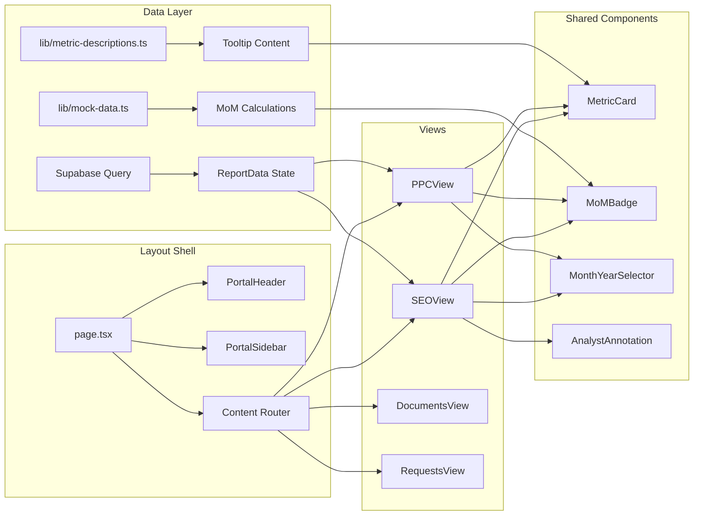

# Premium Enterprise Client Portal — Implementation Plan

> **Revision 2** — Updated with URL-based routing, mobile-responsive sidebar, and security token enforcement.

## Current State Analysis

The existing report page ([`app/report/[id]/page.tsx`](../my-app/app/report/[id]/page.tsx)) is a **single 570-line monolithic component** using horizontal tabs (SEO, PPC, Documents). It fetches data from Supabase and renders everything inline. The UI is functional but lacks the premium, corporate feel of an enterprise client portal.

**Key technical facts:**
- **Framework:** Next.js 16, React 19, Tailwind CSS v4 (configured via CSS `@import`, no `tailwind.config.ts`)
- **Backend:** Supabase (clients, reports, metrics_snapshots, narratives)
- **Already installed:** `lucide-react`, `recharts`, shadcn/ui components
- **Missing:** `react-markdown`, `@tailwindcss/typography`
- **Routing:** App Router with `[id]` dynamic segments

---

## Architecture Overview



---

## File Structure (New/Modified)

```
my-app/
├── app/
│   ├── globals.css                          # MODIFY - add @tailwindcss/typography import
│   └── report/
│       └── [id]/
│           └── page.tsx                     # MODIFY - refactor to layout shell with sidebar + security
├── components/
│   ├── portal/
│   │   ├── portal-sidebar.tsx               # NEW - left sidebar with URL search param routing
│   │   ├── portal-header.tsx                # NEW - top header with dual branding + mobile hamburger
│   │   ├── month-year-selector.tsx          # NEW - month/year dropdown for SEO & PPC
│   │   ├── metric-card.tsx                  # NEW - reusable metric card with tooltip
│   │   ├── mom-badge.tsx                    # NEW - MoM change badge (green up / red down)
│   │   ├── analyst-annotation.tsx           # NEW - stylized analyst context block
│   │   ├── seo-view.tsx                     # NEW - full SEO Performance tab content
│   │   ├── ppc-view.tsx                     # NEW - full Paid Media tab content
│   │   ├── documents-view.tsx               # NEW - Documents tab content
│   │   └── requests-view.tsx                # NEW - Requests tab content
│   └── ui/
│       ├── tooltip.tsx                      # NEW - shadcn tooltip component
│       └── sheet.tsx                        # NEW - shadcn sheet component (mobile nav)
├── lib/
│   ├── mock-data.ts                         # NEW - MoM mock generation + static data
│   ├── metric-descriptions.ts               # NEW - professional metric tooltip descriptions
│   └── utils.ts                             # EXISTS - may add formatting helpers
├── supabase/
│   └── migrations/
│       └── 20260622140000_add_secure_access_token.sql  # NEW - security migration
```

---

## Phase 0: Security — Secure Access Token

### 0.1 Supabase Migration
**File:** `supabase/migrations/20260622140000_add_secure_access_token.sql`
- Add `secure_access_token UUID DEFAULT gen_random_uuid() NOT NULL` to the `clients` table
- Add a unique index on `secure_access_token` for fast lookups
- Backfill existing rows with generated UUIDs

### 0.2 Security Enforcement in Page
- The report page URL format becomes: `/report/[id]?tab=seo&key=[secure_access_token]`
- Server-side: fetch the report, then compare `searchParams.key` against `client.secure_access_token`
- If missing or mismatched: render a 401/404 unauthorized state (no data leakage)
- Update the `types.ts` Client type to include `secure_access_token`

---

## Phase 1: Dependencies & Core Layout Shell

### 1.1 Install Dependencies
```bash
npm install react-markdown @tailwindcss/typography
```
> `lucide-react` is already installed.

### 1.2 Configure Tailwind Typography Plugin
Since this project uses **Tailwind CSS v4** with CSS-based configuration, we add the typography plugin via CSS import in [`globals.css`](../my-app/app/globals.css):
```css
@import "tailwindcss";
@import "@tailwindcss/typography";
@import "tw-animate-css";
@import "shadcn/tailwind.css";
```

### 1.3 Add shadcn Tooltip & Sheet Components
- Add `tooltip.tsx` for metric info icons
- Add `sheet.tsx` for mobile slide-out navigation menu

### 1.4 Create Portal Header Component
**File:** `components/portal/portal-header.tsx`
- Left side: Brew Digital logo text + "Client Portal" label with separator
- Right side: Dynamic `company_name` + `logo_url` (or colored initial fallback)
- **Mobile hamburger menu:** `flex md:hidden` button that opens a Sheet containing nav links
- Sticky top, white background, subtle bottom border
- Clean, minimal Apple-esque styling

### 1.5 Create Portal Sidebar Component
**File:** `components/portal/portal-sidebar.tsx`
- **Desktop:** Permanent left sidebar, `hidden md:flex`, width ~240px fixed
- **Mobile:** Hidden (navigation handled by header hamburger Sheet)
- **URL-based routing:** Reads `?tab=` search param via `useSearchParams()`
- Navigation items push new query params via `useRouter().push()`
- Default to `?tab=seo` if no parameter present
- Four navigation items with icons from lucide-react:
  - `BarChart3` — SEO Performance
  - `Target` — Paid Media (PPC)
  - `FileText` — Documents
  - `Inbox` — Requests
- Active state: subtle background highlight + left accent border using client `primary_color_hex`
- No emojis in the sidebar labels (clean corporate look)

### 1.6 Refactor Main Report Page
**File:** `app/report/[id]/page.tsx`
- **Security check first:** Validate `key` search param against `client.secure_access_token`
- Keep the Supabase data fetching logic
- Replace the horizontal `<Tabs>` layout with a sidebar + content area layout
- Read `?tab=` search param to determine active view (default: `seo`)
- Render the appropriate view component based on active tab
- Layout structure:
  ```
  ┌─────────────────────────────────────────────┐
  │  Portal Header  [☰ mobile]    Client Logo   │
  ├──────────┬──────────────────────────────────┤
  │          │                                   │
  │ Sidebar  │        Main Content Area          │
  │ (desktop)│   (switches based on ?tab=)       │
  │          │                                   │
  └──────────┴──────────────────────────────────┘
  ```

---

## Phase 2: Time Control & State Management

### 2.1 Create Month/Year Selector Component
**File:** `components/portal/month-year-selector.tsx`
- Clean dropdown showing month + year (e.g., "May 2026")
- Positioned top-right of the content area
- Only rendered when `activeTab` is `seo` or `ppc`
- Reads `reporting_month` from the report data as the current selection
- For MVP: single-select, non-functional beyond display (since we have one month of data)

### 2.2 Create MoM Mock Data Helper
**File:** `lib/mock-data.ts`
- `generateMoMChange(currentValue: number, options?)` function
- If no historical data exists, generates a random previous value within +/- 5% to 15% of current
- Returns `{ previousValue, changePercent, direction: 'up' | 'down' | 'flat' }`
- Uses a seeded approach (based on metric name hash) so values are consistent across re-renders
- Exported for use in both SEO and PPC views

### 2.3 Create MoM Badge Component
**File:** `components/portal/mom-badge.tsx`
- Displays `↑ 8.3%` in green or `↓ 4.1%` in red
- Accepts `changePercent` and `direction` props
- Optional `invertColors` prop (for metrics where "down" is good, like error counts)
- Subtle, pill-shaped badge with appropriate background tint

---

## Phase 3: Rebuilding the SEO View

### 3.1 Create SEO View Component
**File:** `components/portal/seo-view.tsx`
- Receives `metrics`, `narrativeText`, `clientColor`, `reportingMonth` as props
- Composed of sub-sections below

### 3.2 Executive Summary with ReactMarkdown
- Render `narrativeText` using `<ReactMarkdown className="prose prose-slate max-w-none">`
- Strip emojis from section headers using a regex utility
- Wrapped in a premium card with left accent border using `clientColor`

### 3.3 Technical Health Metric Cards with Tooltips
**File:** `components/portal/metric-card.tsx`
- Each card shows: metric value, label, MoM badge, and an info icon
- Info icon triggers a tooltip/popover with professional metric description
- Descriptions stored in `lib/metric-descriptions.ts`:
  - **Total URLs:** "The total number of unique URLs discovered during the technical crawl..."
  - **Non-Indexable:** "Pages blocked from search engine indexing via robots.txt, noindex tags..."
  - **3xx Redirects:** "Indicates URLs that forward to new destinations. Essential for preserving link equity..."
  - **4xx Errors:** "Client-side errors indicating broken or missing pages..."
  - **5xx Errors:** "Server-side errors indicating infrastructure or application failures..."
  - **Missing H1:** "Pages lacking a primary heading tag, which impacts content hierarchy..."

### 3.4 Charts with Analyst Annotations
- Keep existing Recharts (Indexability Donut, Status Code Bar)
- Add `components/portal/analyst-annotation.tsx` — a styled block below each chart
- Light background, left border accent, italic text providing qualitative context
- Example: "The indexability ratio remains healthy at 94%. The 6% non-indexable pages are primarily paginated archive pages and intentional noindex tags on staging content."

### 3.5 Data Tables (Wireframe Placeholders)
- **Top Keyword Movements (SE Ranking):** Clean table with columns: Keyword, Position, Change, Search Volume, URL
- **Traffic by Channel (GA4):** Table with columns: Channel, Sessions, Users, Bounce Rate, Avg. Duration
- Both populated with realistic static mock data
- Corporate styling: alternating row backgrounds, clean typography

---

## Phase 4: The Paid Media (PPC) View

### 4.1 Create PPC View Component
**File:** `components/portal/ppc-view.tsx`
- Premium accordion/collapsible list for 3 static campaigns

### 4.2 Campaign Accordion — Collapsed State
Each collapsed row displays:
- Campaign name (bold)
- Four metric pills: **Spend**, **Conversions**, **CPA**, **ROAS**
- Each metric has a MoM badge (using the mock helper from Phase 2)
- Chevron icon for expand/collapse

### 4.3 Campaign Accordion — Expanded State
Two sections inside each expanded campaign:

**Target Keywords Performance Table:**
| Keyword | Match Type | Clicks | Impressions | CTR | Avg. CPC | Conversions |
|---------|-----------|--------|-------------|-----|----------|-------------|
| (mock data rows) |

**Top Performing Ad Creatives:**
- 2-3 mocked ad creative blocks per campaign
- Each block shows: Headline, Description lines, Display URL, and performance metrics (CTR, Conversions)
- Styled as card-like blocks resembling Google Ads preview format

### 4.4 PPC Summary Card
- Keep the existing executive summary text
- Render with ReactMarkdown + prose styling for consistency

---

## Phase 5: The Portal Tools (Documents & Requests)

### 5.1 Documents View
**File:** `components/portal/documents-view.tsx`
- Clean data table with existing static document data
- Columns: File Name (with icon), Type (badge), Size, Date, Action (Download button)
- No time filters shown (timeless tab)
- Premium table styling with hover states

### 5.2 Requests View
**File:** `components/portal/requests-view.tsx`

**New Request Form:**
- Title (text input)
- Description (textarea)
- Priority dropdown (Low, Medium, High, Urgent)
- Submit button (styled with client color)
- Form is UI-only for MVP (no backend integration)

**Open Tickets Table:**
- Static mock data representing open requests
- Columns: Ticket ID, Title, Priority (color-coded badge), Status, Created Date
- 3-4 mock rows showing different states (Open, In Progress, Awaiting Response)
- Subtle note: "Powered by Jira Service Desk" watermark/badge at bottom

---

## Component Dependency Flow



---

## Key Design Decisions

1. **No `tailwind.config.ts`:** Tailwind v4 uses CSS-based config. Typography plugin added via `@import "@tailwindcss/typography"` in `globals.css`.

2. **URL-based routing via search params:** Tab switching uses `?tab=seo|ppc|documents|requests` search parameters instead of `useState`. This enables deep-linking so account managers can share direct links to specific tabs. Default: `?tab=seo`.

3. **Mobile-responsive sidebar:** Desktop shows a permanent 240px sidebar (`hidden md:flex`). Mobile hides the sidebar and shows a hamburger menu in the header that opens a shadcn Sheet slide-out with navigation links.

4. **Security via `secure_access_token`:** A UUID token on the `clients` table is validated against the `?key=` URL parameter. Missing or invalid keys render a 401/404 — no data leakage. This prevents IDOR attacks from URL guessing.

5. **Seeded mock MoM data:** The mock data generator uses a hash of the metric name to seed random values, ensuring consistent MoM percentages across page refreshes (no flickering values).

6. **Modular component architecture:** The monolithic 570-line page is decomposed into ~12 focused components, each under 150 lines, improving maintainability.

7. **No emoji in navigation/headers:** Per the brief, all emojis are stripped from section headers and sidebar labels for a clean corporate aesthetic.

8. **Tooltip + Sheet components:** shadcn tooltip for metric info icons, shadcn Sheet for mobile navigation drawer.
