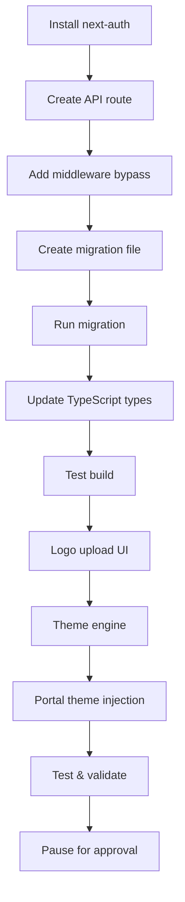
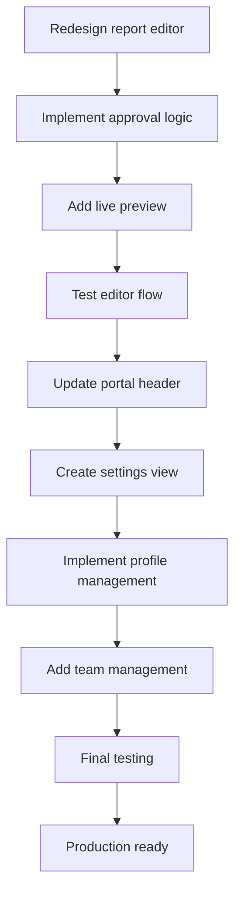

# Enterprise UX Polish, Approval Workflows, & Contextual Editor

**Date:** 2026-06-22  
**Status:** Planning Phase  
**Execution Mode:** Sequential (Phase 1 → Phase 2 → Phase 3 → Phase 4)

---

## 🎯 Overview

Upgrading the SEO dashboard to production-grade with:
- **Multi-user authentication** (agency staff + client users)
- **Approval workflows** for report publishing
- **Advanced theming** with manual overrides
- **Logo management** (URL + file upload)
- **WYSIWYG contextual editor** redesign
- **Client portal enhancements** (profiles, team management, support tickets)

---

## 📋 Critical Rules

1. ✅ Execute phases **sequentially** (wait for approval between phases)
2. ✅ Use **surgical diffs** (apply_diff) for existing files
3. ✅ Ensure `npm run build` passes cleanly after each phase
4. ✅ Auth framework must include **local bypass** for development

---

## 🔐 Phase 1: Database Expansion & Auth Framework

### 1.1 NextAuth Installation & Configuration

**Package Installation:**
```bash
npm install next-auth@latest react-dropzone@latest
```

**Environment Variables (.env.local):**
```env
NEXTAUTH_URL=http://localhost:3000
NEXTAUTH_SECRET=<auto-generated-64-char-random-string>
OKTA_CLIENT_ID=<placeholder>
OKTA_CLIENT_SECRET=<placeholder>
OKTA_ISSUER=<placeholder>
```

**Note:** NEXTAUTH_SECRET will be auto-generated using crypto.randomBytes(32).toString('hex')

### 1.2 NextAuth API Route

**File:** [`my-app/app/api/auth/[...nextauth]/route.ts`](my-app/app/api/auth/[...nextauth]/route.ts)

```typescript
import NextAuth from 'next-auth';
import OktaProvider from 'next-auth/providers/okta';

export const authOptions = {
  providers: [
    OktaProvider({
      clientId: process.env.OKTA_CLIENT_ID || 'placeholder',
      clientSecret: process.env.OKTA_CLIENT_SECRET || 'placeholder',
      issuer: process.env.OKTA_ISSUER || 'placeholder',
    }),
  ],
  callbacks: {
    async session({ session, token }) {
      // Attach user metadata from agency_users table
      return session;
    },
  },
};

const handler = NextAuth(authOptions);
export { handler as GET, handler as POST };
```

### 1.3 Local Development Bypass

**Strategy:** Create middleware that checks for `NODE_ENV === 'development'` and allows access to `/admin` and `/report` routes without authentication.

**File:** [`my-app/middleware.ts`](my-app/middleware.ts)

```typescript
import { NextResponse } from 'next/server';
import type { NextRequest } from 'next/server';

export function middleware(request: NextRequest) {
  // Local bypass: allow all access in development
  if (process.env.NODE_ENV === 'development') {
    return NextResponse.next();
  }

  // Production: check authentication (to be implemented)
  // For now, allow access (auth framework only)
  return NextResponse.next();
}

export const config = {
  matcher: ['/admin/:path*', '/report/:path*'],
};
```

### 1.4 Database Migration: Enterprise Users & Theming

**File:** [`supabase/migrations/20260622190000_enterprise_users_and_theming.sql`](supabase/migrations/20260622190000_enterprise_users_and_theming.sql)

```sql
-- =====================================================
-- AGENCY STAFF TABLE
-- =====================================================

CREATE TABLE agency_users (
  id UUID PRIMARY KEY DEFAULT gen_random_uuid(),
  email TEXT UNIQUE NOT NULL,
  name TEXT NOT NULL,
  can_approve_reports BOOLEAN NOT NULL DEFAULT false,
  created_at TIMESTAMPTZ NOT NULL DEFAULT now()
);

CREATE INDEX idx_agency_users_email ON agency_users(email);

-- =====================================================
-- CLIENTS TABLE UPDATES
-- =====================================================

-- Approval workflow flag
ALTER TABLE clients ADD COLUMN approval_required BOOLEAN NOT NULL DEFAULT true;

-- Logo storage path (works alongside logo_url)
ALTER TABLE clients ADD COLUMN logo_storage_path TEXT;

-- Theme overrides (JSONB for secondary/accent colors)
ALTER TABLE clients ADD COLUMN theme_overrides JSONB DEFAULT '{}'::jsonb;

COMMENT ON COLUMN clients.logo_storage_path IS 'Supabase storage path for uploaded logo files';
COMMENT ON COLUMN clients.theme_overrides IS 'Manual color overrides: {"secondary": "#hex", "accent": "#hex"}';

-- =====================================================
-- CLIENT USERS TABLE
-- =====================================================

CREATE TABLE client_users (
  id UUID PRIMARY KEY DEFAULT gen_random_uuid(),
  client_id UUID NOT NULL REFERENCES clients(id) ON DELETE CASCADE,
  name TEXT NOT NULL,
  email TEXT NOT NULL,
  avatar_url TEXT,
  role TEXT NOT NULL DEFAULT 'member',
  created_at TIMESTAMPTZ NOT NULL DEFAULT now(),
  UNIQUE(client_id, email)
);

CREATE INDEX idx_client_users_client_id ON client_users(client_id);
CREATE INDEX idx_client_users_email ON client_users(email);

COMMENT ON COLUMN client_users.role IS 'User role: admin, member, viewer';

-- =====================================================
-- STORAGE BUCKETS
-- =====================================================

-- Client logos bucket
INSERT INTO storage.buckets (id, name, public, file_size_limit, allowed_mime_types)
VALUES (
  'client_logos',
  'client_logos',
  true, -- Public for easy rendering
  5242880, -- 5MB limit
  ARRAY['image/png', 'image/jpeg', 'image/svg+xml', 'image/webp']
)
ON CONFLICT (id) DO NOTHING;

-- User avatars bucket
INSERT INTO storage.buckets (id, name, public, file_size_limit, allowed_mime_types)
VALUES (
  'user_avatars',
  'user_avatars',
  true, -- Public for easy rendering
  2097152, -- 2MB limit
  ARRAY['image/png', 'image/jpeg', 'image/webp']
)
ON CONFLICT (id) DO NOTHING;

-- =====================================================
-- STORAGE POLICIES
-- =====================================================

-- Client logos: allow upload/read/delete
CREATE POLICY "allow_upload_client_logos"
ON storage.objects FOR INSERT
WITH CHECK (bucket_id = 'client_logos');

CREATE POLICY "allow_read_client_logos"
ON storage.objects FOR SELECT
USING (bucket_id = 'client_logos');

CREATE POLICY "allow_delete_client_logos"
ON storage.objects FOR DELETE
USING (bucket_id = 'client_logos');

-- User avatars: allow upload/read/delete
CREATE POLICY "allow_upload_user_avatars"
ON storage.objects FOR INSERT
WITH CHECK (bucket_id = 'user_avatars');

CREATE POLICY "allow_read_user_avatars"
ON storage.objects FOR SELECT
USING (bucket_id = 'user_avatars');

CREATE POLICY "allow_delete_user_avatars"
ON storage.objects FOR DELETE
USING (bucket_id = 'user_avatars');
```

### 1.5 TypeScript Types Update

**File:** [`my-app/lib/types.ts`](my-app/lib/types.ts)

Add new table types:

```typescript
export interface Database {
  public: {
    Tables: {
      // ... existing tables ...
      agency_users: {
        Row: {
          id: string;
          email: string;
          name: string;
          can_approve_reports: boolean;
          created_at: string;
        };
        Insert: {
          id?: string;
          email: string;
          name: string;
          can_approve_reports?: boolean;
          created_at?: string;
        };
        Update: {
          id?: string;
          email?: string;
          name?: string;
          can_approve_reports?: boolean;
          created_at?: string;
        };
      };
      client_users: {
        Row: {
          id: string;
          client_id: string;
          name: string;
          email: string;
          avatar_url: string | null;
          role: string;
          created_at: string;
        };
        Insert: {
          id?: string;
          client_id: string;
          name: string;
          email: string;
          avatar_url?: string | null;
          role?: string;
          created_at?: string;
        };
        Update: {
          id?: string;
          client_id?: string;
          name?: string;
          email?: string;
          avatar_url?: string | null;
          role?: string;
          created_at?: string;
        };
      };
    };
  };
}
```

Update `clients` table type to include new fields:
- `approval_required: boolean`
- `logo_storage_path: string | null`
- `theme_overrides: Record<string, string> | null`

---

## 🎨 Phase 2: Theme Engine, Logos, & Report Deletion

### 2.1 Delete Report Functionality

**Status:** ✅ Already implemented in [`my-app/app/admin/client/[id]/page.tsx`](my-app/app/admin/client/[id]/page.tsx:72-98)

The delete functionality with confirmation dialog is already present. No changes needed.

### 2.2 Logo Upload UI (Either/Or)

**File:** [`my-app/components/admin/client-settings-form.tsx`](my-app/components/admin/client-settings-form.tsx:93-102)

**Changes Required:**
1. Add file input with dropzone UI
2. Implement file upload to `client_logos` bucket
3. Save `logo_storage_path` to database
4. Show preview of current logo (URL or storage path)
5. Allow switching between URL and file upload

**UI Flow:**
```
┌─────────────────────────────────────┐
│ Logo Configuration                  │
├─────────────────────────────────────┤
│ ○ External URL                      │
│   [https://example.com/logo.png]    │
│                                     │
│ ○ Upload File                       │
│   ┌───────────────────────────┐    │
│   │  Drop logo here or click  │    │
│   │  PNG, JPG, SVG (max 5MB)  │    │
│   └───────────────────────────┘    │
│                                     │
│ Current Logo:                       │
│ [Preview thumbnail]                 │
└─────────────────────────────────────┘
```

### 2.3 Logo File Upload Implementation

**New Utility:** [`my-app/lib/storage-helpers.ts`](my-app/lib/storage-helpers.ts)

```typescript
import { supabase } from './supabase';

export async function uploadClientLogo(
  clientId: string,
  file: File
): Promise<{ path: string; url: string } | null> {
  try {
    const fileExt = file.name.split('.').pop();
    const fileName = `${clientId}-${Date.now()}.${fileExt}`;
    const filePath = `logos/${fileName}`;

    const { data, error } = await supabase.storage
      .from('client_logos')
      .upload(filePath, file, {
        cacheControl: '3600',
        upsert: true,
      });

    if (error) throw error;

    const { data: { publicUrl } } = supabase.storage
      .from('client_logos')
      .getPublicUrl(filePath);

    return { path: filePath, url: publicUrl };
  } catch (error) {
    console.error('Error uploading logo:', error);
    return null;
  }
}

export async function deleteClientLogo(path: string): Promise<boolean> {
  try {
    const { error } = await supabase.storage
      .from('client_logos')
      .remove([path]);

    if (error) throw error;
    return true;
  } catch (error) {
    console.error('Error deleting logo:', error);
    return false;
  }
}
```

### 2.4 Logo Rendering Logic

**Update:** [`my-app/components/portal/portal-header.tsx`](my-app/components/portal/portal-header.tsx:118-131)

Add helper function to resolve logo URL:

```typescript
function getLogoUrl(logoUrl: string | null, logoStoragePath: string | null): string | null {
  if (logoStoragePath) {
    const { data } = supabase.storage
      .from('client_logos')
      .getPublicUrl(logoStoragePath);
    return data.publicUrl;
  }
  return logoUrl;
}
```

### 2.5 Advanced Theme Engine

**File:** [`my-app/lib/theme-engine.ts`](my-app/lib/theme-engine.ts)

```typescript
/**
 * Theme Engine: Generates complementary color palette from primary hex
 * Supports manual overrides via theme_overrides JSONB
 */

interface ThemeOverrides {
  secondary?: string;
  accent?: string;
}

interface ThemePalette {
  primary: string;
  primaryHSL: string;
  secondary: string;
  secondaryHSL: string;
  accent: string;
  accentHSL: string;
}

/**
 * Convert hex to HSL
 */
function hexToHSL(hex: string): { h: number; s: number; l: number } {
  // Remove # if present
  hex = hex.replace('#', '');

  // Convert to RGB
  const r = parseInt(hex.substring(0, 2), 16) / 255;
  const g = parseInt(hex.substring(2, 4), 16) / 255;
  const b = parseInt(hex.substring(4, 6), 16) / 255;

  const max = Math.max(r, g, b);
  const min = Math.min(r, g, b);
  let h = 0;
  let s = 0;
  const l = (max + min) / 2;

  if (max !== min) {
    const d = max - min;
    s = l > 0.5 ? d / (2 - max - min) : d / (max + min);

    switch (max) {
      case r:
        h = ((g - b) / d + (g < b ? 6 : 0)) / 6;
        break;
      case g:
        h = ((b - r) / d + 2) / 6;
        break;
      case b:
        h = ((r - g) / d + 4) / 6;
        break;
    }
  }

  return {
    h: Math.round(h * 360),
    s: Math.round(s * 100),
    l: Math.round(l * 100),
  };
}

/**
 * Generate complementary secondary color (180° hue shift)
 */
function generateSecondary(primaryHSL: { h: number; s: number; l: number }): string {
  const h = (primaryHSL.h + 180) % 360;
  return `${h} ${primaryHSL.s}% ${primaryHSL.l}%`;
}

/**
 * Generate accent color (triadic: 120° hue shift)
 */
function generateAccent(primaryHSL: { h: number; s: number; l: number }): string {
  const h = (primaryHSL.h + 120) % 360;
  return `${h} ${primaryHSL.s}% ${Math.min(primaryHSL.l + 10, 90)}%`;
}

/**
 * Main theme engine: generates full palette with override support
 */
export function generateThemePalette(
  primaryHex: string,
  overrides?: ThemeOverrides
): ThemePalette {
  const primaryHSL = hexToHSL(primaryHex);
  const primaryHSLString = `${primaryHSL.h} ${primaryHSL.s}% ${primaryHSL.l}%`;

  // Check for manual overrides
  const secondaryHSL = overrides?.secondary
    ? hexToHSL(overrides.secondary)
    : null;
  const accentHSL = overrides?.accent
    ? hexToHSL(overrides.accent)
    : null;

  return {
    primary: primaryHex,
    primaryHSL: primaryHSLString,
    secondary: overrides?.secondary || primaryHex,
    secondaryHSL: secondaryHSL
      ? `${secondaryHSL.h} ${secondaryHSL.s}% ${secondaryHSL.l}%`
      : generateSecondary(primaryHSL),
    accent: overrides?.accent || primaryHex,
    accentHSL: accentHSL
      ? `${accentHSL.h} ${accentHSL.s}% ${accentHSL.l}%`
      : generateAccent(primaryHSL),
  };
}

/**
 * Inject CSS variables into portal wrapper
 */
export function injectThemeVariables(palette: ThemePalette): string {
  return `
    --theme-primary: ${palette.primary};
    --theme-primary-hsl: ${palette.primaryHSL};
    --theme-secondary: ${palette.secondary};
    --theme-secondary-hsl: ${palette.secondaryHSL};
    --theme-accent: ${palette.accent};
    --theme-accent-hsl: ${palette.accentHSL};
  `.trim();
}
```

### 2.6 Theme Overrides UI

**File:** [`my-app/components/admin/client-settings-form.tsx`](my-app/components/admin/client-settings-form.tsx)

Add advanced theme section:

```tsx
<div className="space-y-3">
  <Label className="text-xs font-medium">Advanced Theme Overrides</Label>
  <div className="grid grid-cols-2 gap-3">
    <div>
      <Label htmlFor="secondary_color" className="text-[10px] text-slate-500">
        Secondary Color (optional)
      </Label>
      <Input
        id="secondary_color"
        value={form.theme_overrides?.secondary || ''}
        onChange={(e) => handleThemeOverride('secondary', e.target.value)}
        placeholder="Auto-generated"
        className="font-mono text-xs"
      />
    </div>
    <div>
      <Label htmlFor="accent_color" className="text-[10px] text-slate-500">
        Accent Color (optional)
      </Label>
      <Input
        id="accent_color"
        value={form.theme_overrides?.accent || ''}
        onChange={(e) => handleThemeOverride('accent', e.target.value)}
        placeholder="Auto-generated"
        className="font-mono text-xs"
      />
    </div>
  </div>
  <p className="text-[10px] text-slate-400">
    Leave blank to auto-generate complementary colors from primary
  </p>
</div>
```

### 2.7 Portal Theme Injection

**File:** [`my-app/app/report/[id]/page.tsx`](my-app/app/report/[id]/page.tsx:161-186)

Wrap portal content with theme variables:

```tsx
const themePalette = generateThemePalette(
  clientColor,
  report.client.theme_overrides || undefined
);

return (
  <div
    className="min-h-screen bg-slate-50 flex flex-col"
    style={{ [injectThemeVariables(themePalette)] } as any}
  >
    {/* Portal content */}
  </div>
);
```

---

## 📝 Phase 3: WYSIWYG Contextual Editor & Live Preview

### 3.1 Report Editor Redesign

**File:** [`my-app/app/admin/reports/[id]/page.tsx`](my-app/app/admin/reports/[id]/page.tsx)

**Current Layout:** 2-column split (Data + Annotations | AI Sections + Widgets)

**New Layout:** Single centered column (max-width 4xl) mirroring client portal

**Contextual Flow:**
1. Top Actionable Priorities Card
2. Executive Summary AI Box
3. Traffic & Visibility Bar Charts → Traffic AI Box
4. Technical Health Metrics → Technical AI Box

### 3.2 Approval Logic

**File:** [`my-app/components/admin/report-publish-bar.tsx`](my-app/components/admin/report-publish-bar.tsx)

**Current:** Simple "Save Draft" / "Publish" buttons

**New Logic:**
```typescript
interface PublishBarProps {
  reportId: string;
  clientId: string;
  accessKey: string;
  status: 'draft' | 'pending_approval' | 'published';
  onStatusChange: () => void;
  // NEW:
  clientApprovalRequired: boolean;
  currentUserCanApprove: boolean;
}

// Button logic:
if (!currentUserCanApprove && clientApprovalRequired) {
  // Show: "Save as Draft" | "Submit for Approval"
} else {
  // Show: "Save as Draft" | "Approve & Publish"
}
```

### 3.3 Live Preview

Add "Live Preview" button to header:

```tsx
<Button
  variant="outline"
  size="sm"
  onClick={() => window.open(`/report/${reportId}?preview=true&key=${accessKey}`, '_blank')}
>
  <ExternalLink className="h-3.5 w-3.5 mr-1.5" />
  Live Preview
</Button>
```

Update [`my-app/app/report/[id]/page.tsx`](my-app/app/report/[id]/page.tsx:69-74) to bypass published check:

```typescript
const isPreview = searchParams.get('preview') === 'true';

// Security: validate access token
if (!accessKey || reportData.client.secure_access_token !== accessKey) {
  setUnauthorized(true);
  return;
}

// Allow preview mode to bypass published status
if (!isPreview && reportData.published_status !== 'published') {
  setUnauthorized(true);
  return;
}
```

---

## 👥 Phase 4: Client Portal - User Management & Profiles

### 4.1 Portal Global Header Update

**File:** [`my-app/components/portal/portal-header.tsx`](my-app/components/portal/portal-header.tsx:103-111)

**Changes:**
1. Hardcode Brew Digital logo/SVG (always visible)
2. Add "Sign Out" button (stubbed)

```tsx
{/* Brew Digital branding */}
<div className="flex items-center gap-2">
  <svg className="h-6 w-6" viewBox="0 0 24 24" fill="currentColor">
    {/* Brew Digital logo SVG path */}
  </svg>
  <span className="font-bold text-lg tracking-tight text-slate-900">
    Brew Digital
  </span>
</div>

{/* Right side: User menu */}
<div className="flex items-center gap-3">
  <Button variant="ghost" size="sm" onClick={() => alert('Sign out (stubbed)')}>
    Sign Out
  </Button>
  {/* Client logo */}
</div>
```

### 4.2 Settings Tab in Client Portal

**New File:** [`my-app/components/portal/settings-view.tsx`](my-app/components/portal/settings-view.tsx)

**Sections:**
1. **My Profile:** Name, email, avatar upload
2. **Team Management:** List of users, invite button
3. **Support Tickets:** Placeholder for account management threads

```tsx
export function SettingsView({ clientId, currentUserId }: Props) {
  return (
    <div className="space-y-6">
      {/* My Profile */}
      <Card>
        <CardHeader>
          <CardTitle>My Profile</CardTitle>
        </CardHeader>
        <CardContent>
          {/* Avatar upload to user_avatars bucket */}
          {/* Name input */}
          {/* Email (read-only) */}
        </CardContent>
      </Card>

      {/* Team Management */}
      <Card>
        <CardHeader>
          <CardTitle>Team Members</CardTitle>
          <Button size="sm">Invite User</Button>
        </CardHeader>
        <CardContent>
          {/* Table of client_users */}
        </CardContent>
      </Card>

      {/* Support Tickets */}
      <Card>
        <CardHeader>
          <CardTitle>Support Tickets</CardTitle>
        </CardHeader>
        <CardContent>
          <p className="text-sm text-slate-500">
            Coming soon: View and manage support tickets
          </p>
        </CardContent>
      </Card>
    </div>
  );
}
```

### 4.3 Portal Navigation Update

**File:** [`my-app/lib/portal-nav.ts`](my-app/lib/portal-nav.ts)

Add "Settings" tab:

```typescript
export const NAV_ITEMS = [
  { id: 'seo', label: 'SEO Report', icon: 'BarChart3' },
  { id: 'ppc', label: 'PPC Report', icon: 'Target' },
  { id: 'documents', label: 'Documents', icon: 'FileText' },
  { id: 'requests', label: 'Requests', icon: 'Inbox' },
  { id: 'settings', label: 'Settings', icon: 'Settings' }, // NEW
];
```

---

## 🔄 Implementation Workflow

### Phase 1 & 2 Execution (Current Request)



### Phase 3 & 4 Execution (After Approval)



---

## 🧪 Testing Checklist

### Phase 1 & 2
- [ ] NextAuth route responds (even with placeholder credentials)
- [ ] Middleware allows local access to `/admin` and `/report`
- [ ] Migration runs successfully (`supabase db reset`)
- [ ] TypeScript types compile without errors
- [ ] `npm run build` passes cleanly
- [ ] Logo upload saves to `client_logos` bucket
- [ ] Logo renders from both URL and storage path
- [ ] Theme engine generates valid HSL values
- [ ] Theme overrides apply correctly in portal
- [ ] Delete report functionality works

### Phase 3 & 4
- [ ] Report editor shows contextual layout
- [ ] Approval buttons show based on permissions
- [ ] Live preview opens in new tab
- [ ] Preview bypasses published status check
- [ ] Portal header shows Brew Digital branding
- [ ] Settings tab renders in portal
- [ ] Profile updates save to `client_users`
- [ ] Avatar upload works to `user_avatars` bucket
- [ ] Team management table displays users
- [ ] Support tickets placeholder visible

---

## 📦 File Manifest

### New Files (Phase 1 & 2)
- `my-app/app/api/auth/[...nextauth]/route.ts`
- `my-app/middleware.ts`
- `supabase/migrations/20260622190000_enterprise_users_and_theming.sql`
- `my-app/lib/theme-engine.ts`
- `my-app/lib/storage-helpers.ts`

### Modified Files (Phase 1 & 2)
- `my-app/lib/types.ts` (add new table types)
- `my-app/components/admin/client-settings-form.tsx` (logo upload + theme overrides)
- `my-app/components/portal/portal-header.tsx` (logo rendering logic)
- `my-app/app/report/[id]/page.tsx` (theme injection)
- `my-app/package.json` (next-auth dependency)
- `my-app/.env.local` (NextAuth env vars)

### New Files (Phase 3 & 4)
- `my-app/components/portal/settings-view.tsx`

### Modified Files (Phase 3 & 4)
- `my-app/app/admin/reports/[id]/page.tsx` (contextual editor redesign)
- `my-app/components/admin/report-publish-bar.tsx` (approval logic)
- `my-app/components/portal/portal-header.tsx` (Brew Digital branding + sign out)
- `my-app/lib/portal-nav.ts` (add settings tab)
- `my-app/app/report/[id]/page.tsx` (preview mode support)

---

## 🚀 Next Steps

1. **Review this plan** and provide feedback
2. **Approve Phase 1 & 2 execution** or request changes
3. **Execute Phase 1 & 2** sequentially with surgical diffs
4. **Pause for approval** before Phase 3 & 4
5. **Execute Phase 3 & 4** after approval
6. **Final production validation**

---

## ⚠️ Risk Mitigation

| Risk | Mitigation |
|------|------------|
| NextAuth breaks local dev | Middleware bypass ensures `/admin` always accessible |
| Theme engine generates invalid colors | Fallback to primary color if HSL conversion fails |
| Logo upload fails | Keep `logo_url` as fallback option |
| Migration conflicts | Use `ON CONFLICT DO NOTHING` for buckets |
| Build failures | Test `npm run build` after each phase |

---

**Ready to proceed with Phase 1 & 2 implementation?**
