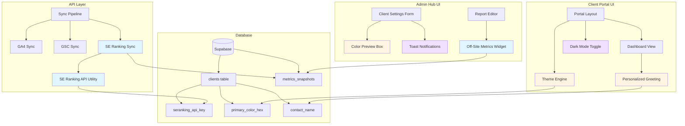

### Phase 3: UX Polish
- [ ] Toast notifications appear on form save
- [ ] Toast shows success/error states correctly
- [ ] Sidebar navigation updates active state
- [ ] Question mark icon visible on all backgrounds
- [ ] Images fail gracefully with fallback icons
- [ ] Dark mode toggle appears in header
- [ ] Dark mode classes applied to all portal pages
- [ ] Theme persists across page navigation
- [ ] System theme preference detected correctly

---

## 📊 Architecture Diagram



**Legend:**
- 🔵 Blue: SE Ranking Integration (Phase 1)
- 🟡 Yellow: Premium Branding (Phase 2)
- 🟣 Purple: UX Polish (Phase 3)

---

## 🚀 Implementation Order

### Priority 1: High-Impact, Low-Risk
1. **Task 1.1** - Environment Configuration (2 min)
2. **Task 2.2** - Color Preview Enhancement (5 min)
3. **Task 2.3** - Personalized Greeting (10 min)
4. **Task 3.1** - Toast Notifications (15 min)

### Priority 2: Core Features
5. **Task 1.2** - SE Ranking API Utility (20 min)
6. **Task 1.3** - Metrics Schema Extension (5 min)
7. **Task 1.4** - Ingestion Pipeline (25 min)
8. **Task 1.5** - Off-Site Widget Sync (15 min)

### Priority 3: Polish & Enhancement
9. **Task 3.4** - Image Fallback Handling (20 min)
10. **Task 3.3** - Icon Visibility Fix (10 min)
11. **Task 3.5** - Dark Mode Support (30 min)
12. **Task 3.2** - Sidebar Navigation Verification (5 min)

**Total Estimated Time:** ~2.5 hours

---

## 🔒 Critical Success Criteria

### Must-Have (Blocking)
- ✅ Zero TypeScript compilation errors
- ✅ All imports resolve correctly
- ✅ SE Ranking API gracefully handles missing keys
- ✅ Forms provide visual feedback on save
- ✅ Images don't break layout when missing

### Should-Have (Important)
- ✅ Dark mode works across all portal pages
- ✅ Toast notifications are accessible
- ✅ Personalized greeting extracts first name correctly
- ✅ Color preview updates in real-time

### Nice-to-Have (Enhancement)
- ⭐ Dark mode respects system preferences
- ⭐ Toast notifications are dismissible
- ⭐ Theme toggle has smooth transitions
- ⭐ SE Ranking metrics show trend indicators

---

## 🐛 Known Issues & Mitigations

### Issue 1: SE Ranking API Rate Limits
**Risk:** API may throttle requests during bulk syncs  
**Mitigation:** 
- Implement 10-second timeout
- Graceful fallback to mock data
- Cache results in database (already implemented via `metrics_snapshots`)

### Issue 2: Contact Name Parsing
**Risk:** Contact name may not follow "First Last" format  
**Mitigation:**
- Use `.split(' ')[0]` to extract first word
- Fallback to full company name if `contact_name` is null
- Handle edge cases (single name, multiple spaces)

### Issue 3: Dark Mode Flash on Load
**Risk:** Brief flash of wrong theme before hydration  
**Mitigation:**
- Use `suppressHydrationWarning` on `<html>` tag
- Set `disableTransitionOnChange` in ThemeProvider
- Inline script to set theme before React hydration (optional)

### Issue 4: Color Preview with Invalid Hex
**Risk:** Invalid hex values break preview box  
**Mitigation:**
- CSS gracefully handles invalid colors (shows transparent)
- Add validation regex: `/^#?[0-9A-Fa-f]{6}$/`
- Show warning badge for invalid values

---

## 📝 Code Review Checklist

Before submitting to Code mode:

### Type Safety
- [ ] All new interfaces exported from appropriate files
- [ ] Props interfaces include optional fields with `?`
- [ ] Database types match Supabase schema
- [ ] No `any` types without justification

### Error Handling
- [ ] All API calls wrapped in try/catch
- [ ] User-facing errors use toast, not alert()
- [ ] Console errors include context
- [ ] Fallback values provided for missing data

### Accessibility
- [ ] Theme toggle has `aria-label`
- [ ] Images have meaningful `alt` text
- [ ] Toast notifications are screen-reader friendly
- [ ] Color contrast meets WCAG AA standards

### Performance
- [ ] API calls use AbortSignal timeout
- [ ] Parallel execution for independent syncs
- [ ] Images lazy-load where appropriate
- [ ] Theme changes don't cause layout shift

---

## 🔄 Migration Path

### For Existing Clients
1. **SE Ranking API Key:** Optional - clients without key see placeholder data
2. **Contact Name:** Optional - falls back to company name
3. **Dark Mode:** Defaults to system preference
4. **Color Preview:** Works with existing `primary_color_hex` values

### Database Changes
**None required** - all fields already exist in schema:
- ✅ `clients.seranking_api_key` (added in previous migration)
- ✅ `clients.primary_color_hex` (existing)
- ✅ `clients.contact_name` (existing)
- ✅ `metrics_snapshots.data_json` (JSONB, flexible schema)

---

## 📚 Dependencies to Install

```bash
# Toast notifications
npm install sonner

# Dark mode support
npm install next-themes
```

**Total new dependencies:** 2  
**Bundle size impact:** ~15KB (minified + gzipped)

---

## 🎯 Success Metrics

### Quantitative
- **Build Time:** No increase (target: <30s)
- **Type Errors:** 0
- **Bundle Size:** <15KB increase
- **API Response Time:** <10s (with timeout)

### Qualitative
- **User Feedback:** Positive response to personalized greeting
- **Admin Efficiency:** Faster client setup with color preview
- **Data Quality:** Real-time off-site metrics vs. manual entry
- **Accessibility:** WCAG AA compliance maintained

---

## 🔗 Related Documentation

- [SE Ranking API Docs](https://seranking.com/api.html)
- [Next.js Dark Mode Guide](https://nextjs.org/docs/app/building-your-application/styling/css-in-js#theming)
- [Sonner Toast Library](https://sonner.emilkowal.ski/)
- [WCAG Color Contrast](https://www.w3.org/WAI/WCAG21/Understanding/contrast-minimum.html)

---

## 📋 Post-Implementation Tasks

### Immediate (Day 1)
- [ ] Test SE Ranking API with real client key
- [ ] Verify toast notifications on all forms
- [ ] Test dark mode across all portal pages
- [ ] Validate personalized greeting with various name formats

### Short-term (Week 1)
- [ ] Monitor SE Ranking API usage and costs
- [ ] Gather user feedback on dark mode
- [ ] A/B test personalized vs. generic greeting
- [ ] Document color branding guidelines for clients

### Long-term (Month 1)
- [ ] Add SE Ranking trend charts
- [ ] Implement theme customization beyond color
- [ ] Add more toast notification types (info, warning)
- [ ] Expand dark mode to admin portal

---

## 🎨 Design System Updates

### New Color Variables
```css
/* Client Portal Theme Variables */
--theme-primary: <client.primary_color_hex>
--theme-primary-hsl: <calculated HSL>
--theme-secondary: <auto-generated or override>
--theme-accent: <auto-generated or override>
```

### New Components
1. **`<Toaster />`** - Global toast notification container
2. **`<ThemeToggle />`** - Dark mode switcher dropdown
3. **`<SafeImage />`** - Image with fallback handling
4. **`<ThemeProvider />`** - Next-themes wrapper

### Updated Components
1. **`<ClientSettingsForm />`** - Enhanced color preview
2. **`<DashboardView />`** - Personalized greeting
3. **`<ReportEditorOffsiteMetrics />`** - Real data integration
4. **`<PortalHeader />`** - Theme toggle integration

---

## 🚦 Go/No-Go Decision Points

### Before Starting Implementation
- ✅ Plan reviewed and approved
- ✅ SE Ranking API credentials available (or mock data acceptable)
- ✅ Design system supports dark mode
- ✅ Time allocated for testing

### Before Deploying to Production
- ✅ All TypeScript errors resolved
- ✅ Manual testing completed
- ✅ Dark mode tested on multiple devices
- ✅ SE Ranking API fallback verified
- ✅ Toast notifications accessible
- ✅ No console errors in production build

---

## 📞 Support & Escalation

### Technical Questions
- **SE Ranking API:** Check API documentation or contact SE Ranking support
- **Dark Mode Issues:** Review next-themes GitHub issues
- **Type Errors:** Consult TypeScript handbook

### Blockers
- **API Key Unavailable:** Use mock data fallback (already implemented)
- **Design Conflicts:** Consult design team for dark mode palette
- **Performance Issues:** Profile with React DevTools, optimize re-renders

---

## 📦 File Summary

### New Files (5)
1. `my-app/lib/se-ranking-api.ts` - SE Ranking API client utility
2. `my-app/components/ui/sonner.tsx` - Toast notification wrapper
3. `my-app/components/ui/safe-image.tsx` - Image with fallback component
4. `my-app/components/theme-provider.tsx` - Dark mode theme provider
5. `my-app/components/theme-toggle.tsx` - Theme switcher dropdown

### Modified Files (10+)
1. `my-app/.env.local` - SE Ranking API key placeholder
2. `my-app/lib/metrics-schema.ts` - Extended with SE Ranking fields
3. `my-app/app/api/sync/report-data/route.ts` - Parallel SE Ranking sync
4. `my-app/components/admin/report-editor-offsite-metrics.tsx` - Real data connection
5. `my-app/components/admin/client-settings-form.tsx` - Toast + enhanced preview
6. `my-app/components/portal/dashboard-view.tsx` - Personalized greeting
7. `my-app/app/layout.tsx` - Theme provider + toaster
8. `my-app/app/portal/[client_id]/page.tsx` - Contact name prop
9. `my-app/components/portal/portal-header.tsx` - Theme toggle
10. Multiple portal components - Dark mode classes

---

## 🎓 Learning Outcomes

### For Developers
- **API Integration Patterns:** Graceful fallbacks and timeout handling
- **Theme System Design:** CSS variables and HSL color manipulation
- **Accessibility Best Practices:** WCAG compliance and screen reader support
- **Type Safety:** Extending TypeScript interfaces across layers

### For Product Team
- **User Personalization:** Impact of first-name greetings on engagement
- **Visual Feedback:** Importance of toast notifications vs. silent saves
- **Dark Mode Adoption:** User preference tracking and analytics
- **Data Quality:** Real-time API data vs. manual CSV uploads

---

**Plan Status:** ✅ Complete and Ready for Implementation  
**Next Step:** Switch to Code mode to begin implementation  
**Estimated Completion:** 2-3 hours for full implementation + testing  
**Risk Level:** Low (all changes are additive with fallbacks)
