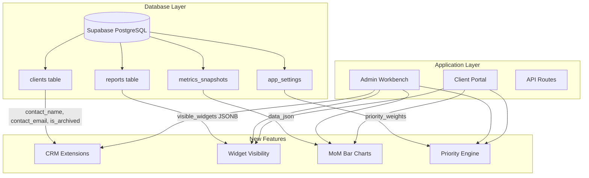
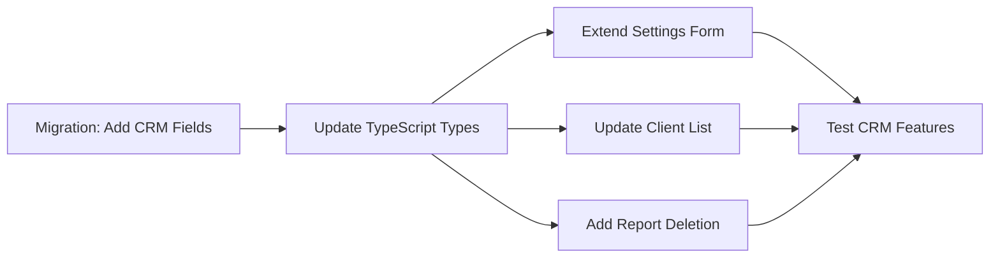
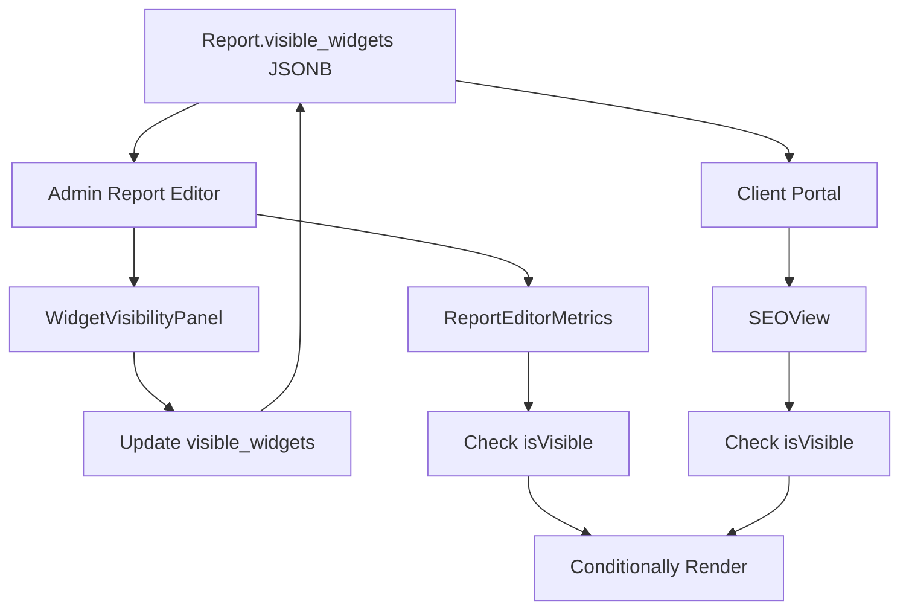
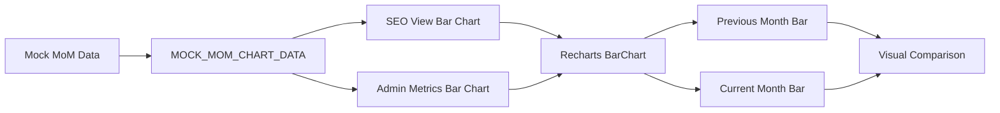
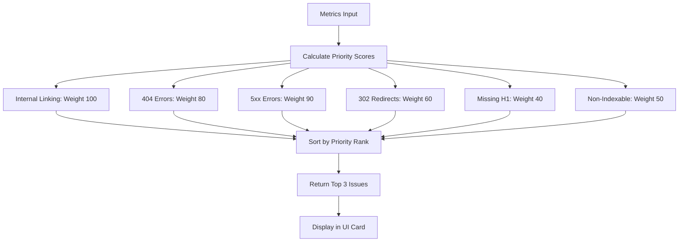

# Sprint to 100% Feature Completeness - Implementation Plan

**Date:** 2026-06-22  
**Status:** Planning Complete - Ready for Implementation  
**Estimated Complexity:** High (22 discrete tasks across 5 phases)

---

## Executive Summary

This sprint delivers the final production-ready features for the SEO Dashboard platform:
- **Client CRM Extensions** - Contact management and archival system
- **Report Deletion** - Safe report removal with cascade handling
- **Widget Visibility Wiring** - Complete layout control for analysts
- **Month-on-Month Bar Charts** - Visual comparison data presentation
- **Top Actionable Priorities Engine** - Automated issue ranking and display
- **Priority Configuration** - Admin-configurable priority weights

---

## System Architecture Overview



---

## Architecture Principles

### 🔧 Token Conservation Strategy
- **Use surgical diffs** via `apply_diff` for all existing file modifications
- **Only use `write_to_file`** for brand new components
- **Minimize context window usage** by targeting specific line ranges

### ✅ Type Safety Requirements
- All changes must maintain TypeScript strict mode compliance
- `npm run build` must pass with zero errors and zero warnings
- Database types must be synchronized with Supabase schema

### 🎯 Implementation Order
Execute phases sequentially to maintain dependency integrity:
1. Database schema changes first
2. Type definitions second
3. UI components third
4. Integration and validation last

---

## Phase 1: Client CRM Extensions & Report Deletion

### Implementation Flow



### 1.1 Database Migration - Client CRM Fields

**File:** `supabase/migrations/20260622180000_client_crm_extensions.sql`

**Action:** Create new migration file

**Schema Changes:**
```sql
-- Add CRM contact fields to clients table
ALTER TABLE clients ADD COLUMN contact_name TEXT;
ALTER TABLE clients ADD COLUMN contact_email TEXT;
ALTER TABLE clients ADD COLUMN is_archived BOOLEAN NOT NULL DEFAULT false;

-- Create index for archived filtering
CREATE INDEX idx_clients_is_archived ON clients(is_archived);

-- Verify reports table has CASCADE delete (already exists from initial schema)
-- The reports table already has: REFERENCES clients(id) ON DELETE CASCADE
-- No changes needed here
```

**Rationale:**
- `contact_name` and `contact_email` enable CRM-style client management
- `is_archived` allows soft deletion without losing historical data
- Index on `is_archived` optimizes the filtered client list query

---

### 1.2 TypeScript Type Updates

**File:** [`my-app/lib/types.ts`](my-app/lib/types.ts:14)

**Action:** Surgical diff to add new fields to Client interface

**Changes Required:**
- Add `contact_name: string | null` to Row type (line ~18)
- Add `contact_email: string | null` to Row type (line ~19)
- Add `is_archived: boolean` to Row type (line ~20)
- Mirror changes in Insert and Update types

**Example:**
```typescript
Row: {
  id: string
  company_name: string
  primary_color_hex: string | null
  logo_url: string | null
  custom_ai_prompt: string | null
  secure_access_token: string
  contact_name: string | null          // NEW
  contact_email: string | null         // NEW
  is_archived: boolean                 // NEW
  jira_api_key: string | null
  // ... rest of fields
}
```

---

### 1.3 Client Settings Form Extension

**File:** [`my-app/components/admin/client-settings-form.tsx`](my-app/components/admin/client-settings-form.tsx:1)

**Action:** Surgical diff to add contact fields and archive toggle

**UI Components to Add:**
1. **Contact Name Input** - Text field for primary contact
2. **Contact Email Input** - Email field with validation
3. **Archive Client Toggle** - Switch component with warning state

**Form State Extension:**
```typescript
const [form, setForm] = useState({
  company_name: client.company_name,
  primary_color_hex: client.primary_color_hex ?? '#3b82f6',
  logo_url: client.logo_url ?? '',
  custom_ai_prompt: client.custom_ai_prompt ?? '',
  contact_name: client.contact_name ?? '',        // NEW
  contact_email: client.contact_email ?? '',      // NEW
  is_archived: client.is_archived ?? false,       // NEW
});
```

**Layout Placement:**
- Add contact fields in a new grid row after logo_url
- Add archive toggle as a separate section with warning styling
- Include helper text: "Archived clients are hidden from the main directory"

---

### 1.4 Client List Filtering

**File:** [`my-app/components/client-list.tsx`](my-app/components/client-list.tsx:1)

**Action:** Surgical diff to add archive filter toggle

**Features:**
1. **State Management:**
   ```typescript
   const [showArchived, setShowArchived] = useState(false);
   ```

2. **Query Modification:**
   ```typescript
   const query = supabase
     .from('clients')
     .select('*')
     .order('created_at', { ascending: false });
   
   if (!showArchived) {
     query.eq('is_archived', false);
   }
   ```

3. **UI Toggle:**
   - Add checkbox/switch above client list
   - Label: "Show Archived Clients"
   - Display archived count when toggled on

---

### 1.5 Report Deletion UI

**File:** [`my-app/app/admin/client/[id]/page.tsx`](my-app/app/admin/client/[id]/page.tsx:164)

**Action:** Surgical diff to add delete action column

**Implementation Steps:**

1. **Add Delete Button to Table:**
   - New TableCell in TableRow (after "Action" cell)
   - Trash icon button with destructive variant

2. **Create Confirmation Dialog:**
   ```typescript
   const [deleteDialogOpen, setDeleteDialogOpen] = useState(false);
   const [reportToDelete, setReportToDelete] = useState<string | null>(null);
   ```

3. **Delete Handler:**
   ```typescript
   const handleDeleteReport = async (reportId: string) => {
     try {
       const { error } = await supabase
         .from('reports')
         .delete()
         .eq('id', reportId);
       
       if (error) throw error;
       await fetchData(); // Refresh list
     } catch (err) {
       console.error('Error deleting report:', err);
       alert('Failed to delete report');
     }
   };
   ```

4. **Dialog Component:**
   - Use existing Dialog component from shadcn/ui
   - Warning message: "This will permanently delete the report and all associated metrics, narratives, and snapshots."
   - Confirm button: "Delete Report" (destructive variant)

---

### 1.6 Verify CASCADE Constraint

**File:** [`supabase/migrations/20260622112100_initial_schema.sql`](supabase/migrations/20260622112100_initial_schema.sql:25)

**Action:** Verification only (no changes needed)

**Confirmation:**
- Line 25 already has: `REFERENCES clients(id) ON DELETE CASCADE`
- This ensures report deletion cascades to metrics_snapshots and narratives
- No migration changes required ✅

---

## Phase 2: Widget Visibility Wiring

### Data Flow Architecture



### 2.1 Admin Report Editor Wiring

**File:** [`my-app/app/admin/reports/[id]/page.tsx`](my-app/app/admin/reports/[id]/page.tsx:1)

**Action:** Surgical diff to add WidgetVisibilityPanel

**Changes:**
1. **Import Component:**
   ```typescript
   import { WidgetVisibilityPanel } from '@/components/admin/widget-visibility-panel';
   ```

2. **Add Panel to Layout:**
   - Insert after ReportEditorAI section (around line 171)
   - Pass `reportId`, `initialWidgets={report.visible_widgets}`, `onSaved={fetchReport}`

3. **Layout Structure:**
   ```tsx
   <div className="space-y-6">
     <ReportEditorAI ... />
     <WidgetVisibilityPanel 
       reportId={reportId}
       initialWidgets={report.visible_widgets}
       onSaved={fetchReport}
     />
   </div>
   ```

---

### 2.2 Report Editor Metrics Visibility

**File:** [`my-app/components/admin/report-editor-metrics.tsx`](my-app/components/admin/report-editor-metrics.tsx:1)

**Action:** Surgical diff to add visibility checks

**Implementation:**

1. **Add Props:**
   ```typescript
   interface ReportEditorMetricsProps {
     metrics: UnifiedMetrics;
     visibleWidgets?: Record<string, boolean>;  // NEW
   }
   ```

2. **Helper Function:**
   ```typescript
   const isVisible = (key: string) => visibleWidgets?.[key] ?? true;
   ```

3. **Wrap Sections:**
   ```tsx
   {isVisible('ga4_traffic') && hasGA4 && (
     <Card>
       {/* GA4 Traffic Card */}
     </Card>
   )}
   
   {isVisible('gsc_queries') && hasGSC && (
     <Card>
       {/* GSC Queries Card */}
     </Card>
   )}
   ```

**Note:** Technical Health card should always be visible (no wrapper needed)

---

### 2.3 Client Portal Report Wiring

**File:** [`my-app/app/report/[id]/page.tsx`](my-app/app/report/[id]/page.tsx:121)

**Action:** Already implemented ✅

**Verification:**
- Line 121 already extracts: `const visibleWidgets = (report as any).visible_widgets ?? undefined;`
- Line 132 already passes to SEOView: `visibleWidgets={visibleWidgets}`
- No changes needed

---

### 2.4 SEO View Conditional Rendering

**File:** [`my-app/components/portal/seo-view.tsx`](my-app/components/portal/seo-view.tsx:56)

**Action:** Already implemented ✅

**Verification:**
- Line 56 already has: `const isVisible = (key: string) => visibleWidgets?.[key] ?? true;`
- Lines 116, 135, 172, 201, 252 already wrap sections with `isVisible()` checks
- No changes needed

---

## Phase 3: Month-on-Month Bar Charts

### Chart Architecture



### 3.1 Mock Data Structure

**File:** [`my-app/lib/mock-data.ts`](my-app/lib/mock-data.ts:1)

**Action:** Add month-on-month comparison data

**New Export:**
```typescript
export const MOCK_MOM_TRAFFIC = {
  organic_traffic: {
    current: 45230,
    previous: 42100,
    change: 7.4,
  },
  active_users: {
    current: 12450,
    previous: 11800,
    change: 5.5,
  },
  gsc_impressions: {
    current: 125000,
    previous: 118000,
    change: 5.9,
  },
};

export const MOCK_MOM_CHART_DATA = [
  { metric: 'Organic Traffic', current: 45230, previous: 42100 },
  { metric: 'Active Users', current: 12450, previous: 11800 },
  { metric: 'Impressions', current: 125000, previous: 118000 },
];
```

---

### 3.2 Bar Chart Implementation - SEO View

**File:** [`my-app/components/portal/seo-view.tsx`](my-app/components/portal/seo-view.tsx:1)

**Action:** Add new MoM comparison card with bar chart

**New Section (insert after Executive Summary, before Technical Health):**
```tsx
{/* Month-on-Month Performance */}
{isVisible('mom_comparison') && (
  <Card>
    <CardHeader>
      <CardTitle className="text-sm">Month-on-Month Performance</CardTitle>
    </CardHeader>
    <CardContent>
      <ResponsiveContainer width="100%" height={300}>
        <BarChart data={MOCK_MOM_CHART_DATA}>
          <CartesianGrid strokeDasharray="3 3" stroke="#f1f5f9" />
          <XAxis dataKey="metric" tick={{ fontSize: 11 }} />
          <YAxis tick={{ fontSize: 11 }} />
          <Tooltip />
          <Legend />
          <Bar dataKey="previous" fill="#cbd5e1" name="Previous Month" radius={[4, 4, 0, 0]} />
          <Bar dataKey="current" fill={clientColor} name="Current Month" radius={[4, 4, 0, 0]} />
        </BarChart>
      </ResponsiveContainer>
      <AnalystAnnotation
        text="Organic traffic increased 7.4% month-on-month, driven by improved rankings for commercial intent keywords. Active user growth of 5.5% indicates strong engagement retention."
        clientColor={clientColor}
      />
    </CardContent>
  </Card>
)}
```

---

### 3.3 Bar Chart Implementation - Admin Metrics

**File:** [`my-app/components/admin/report-editor-metrics.tsx`](my-app/components/admin/report-editor-metrics.tsx:1)

**Action:** Add MoM comparison card for analyst view

**New Section (insert after Technical Health, before GA4 Traffic):**
```tsx
{/* Month-on-Month Comparison */}
{isVisible('mom_comparison') && (
  <Card>
    <CardHeader className="pb-2">
      <CardTitle className="text-sm">Month-on-Month Comparison</CardTitle>
    </CardHeader>
    <CardContent>
      <ResponsiveContainer width="100%" height={260}>
        <BarChart data={MOCK_MOM_CHART_DATA}>
          <CartesianGrid strokeDasharray="3 3" stroke="#f1f5f9" />
          <XAxis dataKey="metric" tick={{ fontSize: 11 }} />
          <YAxis tick={{ fontSize: 11 }} />
          <Tooltip />
          <Legend />
          <Bar dataKey="previous" fill="#cbd5e1" name="Previous" radius={[4, 4, 0, 0]} />
          <Bar dataKey="current" fill="#3b82f6" name="Current" radius={[4, 4, 0, 0]} />
        </BarChart>
      </ResponsiveContainer>
    </CardContent>
  </Card>
)}
```

**Import Required:**
```typescript
import { MOCK_MOM_CHART_DATA } from '@/lib/mock-data';
```

---

### 3.4 Update Widget Visibility Panel

**File:** [`my-app/components/admin/widget-visibility-panel.tsx`](my-app/components/admin/widget-visibility-panel.tsx:9)

**Action:** Add mom_comparison to DEFAULT_WIDGETS

**Change:**
```typescript
export const DEFAULT_WIDGETS: Record<string, string> = {
  technical_health: 'Technical Health Cards',
  indexability_chart: 'Indexability Chart',
  status_code_chart: 'Status Code Chart',
  mom_comparison: 'Month-on-Month Comparison',  // NEW
  ga4_traffic: 'GA4 Traffic Table',
  gsc_queries: 'GSC Queries Table',
  keyword_movements: 'Keyword Movements',
  traffic_channels: 'Traffic by Channel',
};
```

---

## Phase 4: Top Actionable Priorities Engine

### Priority Ranking Algorithm



### 4.1 Priority Calculation Helper

**File:** `my-app/lib/priority-calculator.ts` (NEW FILE)

**Action:** Create new utility file

**Key Features:**
- Configurable priority weights with sensible defaults
- Automatic severity classification (critical/high/medium)
- Top 3 issue ranking based on weighted scores
- Extensible for future metric additions

**Implementation:**
```typescript
import type { UnifiedMetrics } from './metrics-schema';

export interface PriorityIssue {
  id: string;
  title: string;
  description: string;
  severity: 'critical' | 'high' | 'medium';
  metric_value: number;
  category: 'internal_linking' | '404_errors' | '302_redirects' | 'technical';
  priority_rank: number;
}

export interface PriorityWeights {
  internal_linking: number;
  errors_404: number;
  redirects_302: number;
  errors_5xx: number;
  missing_h1: number;
  non_indexable: number;
}

export const DEFAULT_PRIORITY_WEIGHTS: PriorityWeights = {
  internal_linking: 100,  // Highest priority
  errors_404: 80,
  redirects_302: 60,
  errors_5xx: 90,
  missing_h1: 40,
  non_indexable: 50,
};

/**
 * Calculate top actionable priorities based on metrics and configurable weights.
 * Returns top 3 issues ranked by severity and impact.
 */
export function calculateReportPriorities(
  metrics: UnifiedMetrics,
  customWeights?: Partial<PriorityWeights>
): PriorityIssue[] {
  const weights = { ...DEFAULT_PRIORITY_WEIGHTS, ...customWeights };
  const issues: PriorityIssue[] = [];

  // Priority 1: Internal Linking Issues (simulated - would come from SF data)
  const orphanedPages = 0; // TODO: Add to metrics schema when SF parser is enhanced
  if (orphanedPages > 10) {
    issues.push({
      id: 'internal_linking',
      title: 'Internal Linking Issues',
      description: `${orphanedPages} orphaned pages detected with insufficient internal links`,
      severity: 'critical',
      metric_value: orphanedPages,
      category: 'internal_linking',
      priority_rank: weights.internal_linking,
    });
  }

  // Priority 2: 404 Errors
  const errors404 = metrics.client_errors_4xx ?? 0;
  if (errors404 > 0) {
    issues.push({
      id: '404_errors',
      title: '404 Client Errors',
      description: `${errors404} broken URLs returning 404 status codes`,
      severity: errors404 > 50 ? 'critical' : errors404 > 20 ? 'high' : 'medium',
      metric_value: errors404,
      category: '404_errors',
      priority_rank: weights.errors_404,
    });
  }

  // Priority 3: 302 Redirect Misconfigurations
  const redirects302 = metrics.redirects_3xx ?? 0;
  if (redirects302 > 20) {
    issues.push({
      id: '302_redirects',
      title: '302 Redirect Chains',
      description: `${redirects302} temporary redirects detected (should be 301 permanent)`,
      severity: redirects302 > 100 ? 'high' : 'medium',
      metric_value: redirects302,
      category: '302_redirects',
      priority_rank: weights.redirects_302,
    });
  }

  // Additional: 5xx Server Errors (always critical)
  const errors5xx = metrics.server_errors_5xx ?? 0;
  if (errors5xx > 0) {
    issues.push({
      id: '5xx_errors',
      title: '5xx Server Errors',
      description: `${errors5xx} server errors preventing page access`,
      severity: 'critical',
      metric_value: errors5xx,
      category: 'technical',
      priority_rank: weights.errors_5xx,
    });
  }

  // Additional: Missing H1 Tags
  const missingH1 = metrics.missing_h1 ?? 0;
  if (missingH1 > 10) {
    issues.push({
      id: 'missing_h1',
      title: 'Missing H1 Tags',
      description: `${missingH1} pages missing critical H1 heading tags`,
      severity: 'medium',
      metric_value: missingH1,
      category: 'technical',
      priority_rank: weights.missing_h1,
    });
  }

  // Additional: Non-Indexable Pages
  const nonIndexable = metrics.non_indexable ?? 0;
  if (nonIndexable > 50) {
    issues.push({
      id: 'non_indexable',
      title: 'Non-Indexable Pages',
      description: `${nonIndexable} pages blocked from search engine indexing`,
      severity: 'medium',
      metric_value: nonIndexable,
      category: 'technical',
      priority_rank: weights.non_indexable,
    });
  }

  // Sort by priority rank (descending) and return top 3
  return issues
    .sort((a, b) => b.priority_rank - a.priority_rank)
    .slice(0, 3);
}
```

---

### 4.2 Top Priorities Card Component

**File:** `my-app/components/admin/top-priorities-card.tsx` (NEW FILE)

**Action:** Create new component

**Visual Design:**
- Color-coded left border based on highest severity
- Numbered priority badges (1, 2, 3)
- Severity badges (Critical, High, Medium)
- Clean, scannable layout
- Empty state for zero issues

**Implementation:**
```typescript
'use client';

import { Card, CardContent, CardHeader, CardTitle } from '@/components/ui/card';
import { Badge } from '@/components/ui/badge';
import { AlertTriangle, AlertCircle, Info } from 'lucide-react';
import type { PriorityIssue } from '@/lib/priority-calculator';

interface TopPrioritiesCardProps {
  priorities: PriorityIssue[];
  clientColor?: string;
}

export function TopPrioritiesCard({ priorities, clientColor = '#3b82f6' }: TopPrioritiesCardProps) {
  if (priorities.length === 0) {
    return (
      <Card className="border-l-4 border-l-emerald-500">
        <CardHeader>
          <CardTitle className="text-sm flex items-center gap-2">
            <Info className="h-4 w-4 text-emerald-600" />
            Top Actionable Priorities
          </CardTitle>
        </CardHeader>
        <CardContent>
          <p className="text-sm text-slate-600">
            ✅ No critical issues detected. All technical health metrics are within acceptable ranges.
          </p>
        </CardContent>
      </Card>
    );
  }

  const getSeverityIcon = (severity: string) => {
    switch (severity) {
      case 'critical':
        return <AlertTriangle className="h-4 w-4 text-red-600" />;
      case 'high':
        return <AlertCircle className="h-4 w-4 text-orange-600" />;
      default:
        return <Info className="h-4 w-4 text-blue-600" />;
    }
  };

  const getSeverityColor = (severity: string) => {
    switch (severity) {
      case 'critical':
        return 'border-l-red-500';
      case 'high':
        return 'border-l-orange-500';
      default:
        return 'border-l-blue-500';
    }
  };

  const getBadgeVariant = (severity: string) => {
    switch (severity) {
      case 'critical':
        return 'bg-red-50 text-red-700 border-red-200';
      case 'high':
        return 'bg-orange-50 text-orange-700 border-orange-200';
      default:
        return 'bg-blue-50 text-blue-700 border-blue-200';
    }
  };

  return (
    <Card className={`border-l-4 ${getSeverityColor(priorities[0].severity)}`}>
      <CardHeader>
        <CardTitle className="text-sm flex items-center gap-2">
          {getSeverityIcon(priorities[0].severity)}
          Top Actionable Priorities
        </CardTitle>
        <p className="text-xs text-slate-500 mt-1">
          Automatically ranked by impact and urgency
        </p>
      </CardHeader>
      <CardContent>
        <div className="space-y-3">
          {priorities.map((issue, index) => (
            <div
              key={issue.id}
              className="flex items-start gap-3 p-3 rounded-lg bg-slate-50 border border-slate-100"
            >
              <div className="flex-shrink-0 w-6 h-6 rounded-full bg-slate-900 text-white text-xs font-bold flex items-center justify-center">
                {index + 1}
              </div>
              <div className="flex-1 min-w-0">
                <div className="flex items-center gap-2 mb-1">
                  <h4 className="text-sm font-semibold text-slate-900">{issue.title}</h4>
                  <Badge className={`text-[10px] font-medium uppercase tracking-wider ${getBadgeVariant(issue.severity)}`}>
                    {issue.severity}
                  </Badge>
                </div>
                <p className="text-xs text-slate-600 leading-relaxed">
                  {issue.description}
                </p>
              </div>
            </div>
          ))}
        </div>
      </CardContent>
    </Card>
  );
}
```

---

### 4.3 Integrate into Admin Report Editor

**File:** [`my-app/app/admin/reports/[id]/page.tsx`](my-app/app/admin/reports/[id]/page.tsx:1)

**Action:** Surgical diff to add TopPrioritiesCard

**Changes:**

1. **Import:**
   ```typescript
   import { TopPrioritiesCard } from '@/components/admin/top-priorities-card';
   import { calculateReportPriorities } from '@/lib/priority-calculator';
   ```

2. **Calculate Priorities:**
   ```typescript
   const priorities = calculateReportPriorities(metrics);
   ```

3. **Add to Layout (insert before two-column workbench, around line 138):**
   ```tsx
   {/* Top Priorities Alert */}
   <TopPrioritiesCard priorities={priorities} />

   {/* Two-column workbench */}
   <div className="grid grid-cols-1 lg:grid-cols-2 gap-6">
   ```

---

### 4.4 Integrate into Client Portal

**File:** [`my-app/components/portal/seo-view.tsx`](my-app/components/portal/seo-view.tsx:1)

**Action:** Surgical diff to add TopPrioritiesCard

**Changes:**

1. **Import:**
   ```typescript
   import { TopPrioritiesCard } from '@/components/admin/top-priorities-card';
   import { calculateReportPriorities } from '@/lib/priority-calculator';
   ```

2. **Calculate Priorities:**
   ```typescript
   const priorities = calculateReportPriorities(metrics as any);
   ```

3. **Add to Layout (insert after header, before Executive Summary, around line 96):**
   ```tsx
   {/* Top Actionable Priorities */}
   {isVisible('top_priorities') && (
     <TopPrioritiesCard priorities={priorities} clientColor={clientColor} />
   )}

   {/* Executive Summary */}
   {cleanNarrative && (
   ```

4. **Update Widget Visibility Panel:**
   Add `top_priorities: 'Top Actionable Priorities'` to DEFAULT_WIDGETS

---

## Phase 5: Priority Configuration & Final Validation

### 5.1 Admin Settings - Priority Weights

**File:** [`my-app/app/admin/settings/page.tsx`](my-app/app/admin/settings/page.tsx:1)

**Action:** Surgical diff to add priority weights configuration

**UI Layout:**
- New card section after Global AI System Prompt
- Grid layout with 6 numeric inputs (one per weight)
- Save button updates both global prompt and priority weights
- Real-time validation (min: 0, max: 100)

**State Management:**
```typescript
const [priorityWeights, setPriorityWeights] = useState({
  internal_linking: 100,
  errors_404: 80,
  redirects_302: 60,
  errors_5xx: 90,
  missing_h1: 40,
  non_indexable: 50,
});
```

**Database Integration:**
```typescript
// Fetch